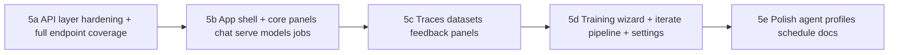

# UI-ROADMAP — sable Phase 5 implementation phases

Status: **complete** — subphases 5a–5e all shipped (each ended green), and the dashboard
grew beyond this plan in later passes: Model Hub, Easy training, multi-instance serving
controls (Phase 6), skills/playbooks/goldens/index/runtime panels. Kept as the execution
plan it was; see [`UI-ARCHITECTURE.md`](UI-ARCHITECTURE.md) status notes for deltas and
the README dashboard tour for the current panel set. Original text below.

Execution plan for [`UI-ARCHITECTURE.md`](UI-ARCHITECTURE.md). Each subphase ends green (full suite +
new tests) and is independently demoable. Headless-testability noted per phase:
**[API]** = covered by `DashboardApp.handle()`/pytest without a browser;
**[HTTP]** = stdlib-server/socket tests; **[UI]** = manual browser checklist
(no browser automation in v1 — see architecture §7).

---

## 5a — Backend API layer hardening + full endpoint coverage

No UI changes (static/ untouched). Pure Python: route matcher, SSE bus, serve
control endpoints, hardware sampler, config read/write, chat run/stream engine,
dataset row preview, iterate run records. This is the keystone phase — after it,
every panel is "just fetch calls".

Work items
1. Route-pattern matcher in `DashboardApp._route` (`<id>` params; PUT/DELETE
   verbs through `server.py`).
2. `EventBus`: per-subscriber queues, thread-safe publish; emit from scheduler
   state transitions, deploy, promote/rollback, trace recorder hook; expose
   `GET /api/events` SSE in `server.py` (handler writes chunked
   `text/event-stream`; clean disconnect handling).
3. Serve endpoints: `GET /api/serve/status`, `POST start|stop|deploy` wrapping
   `ServingSupervisor` + `serving/deploy.py` (spawn server as detached child
   with serve_state.json; **never kill non-owned PIDs**).
4. Hardware sampler: extend nvidia-smi query (`memory.free, memory.total,
   utilization.gpu, temperature.gpu`) in one subprocess call; 2 s TTL cache;
   graceful `null`s without GPU.
5. Config endpoints: `GET/PUT /api/config` with section validation against the
   existing dataclasses (`core/config.py`, `TrainingConfig`, `ValidationConfig`,
   curation config); atomic write; redact `attach_api_key` in GET.
6. Chat engine: worker-subprocess runner (reuse Phase-4 worker pattern) speaking
   NDJSON events → SSE relay at `POST /api/chat/stream`; raw passthrough proxy
   `POST /api/proxy/chat` via `httpx.stream`; thread persistence under
   `<home>/chat/`; `POST /api/chat/cancel`.
7. Dataset rows preview + export endpoints; `GET /api/train/check`;
   `GET /api/traces/stats`; iterate run-record file (`<home>/iterate_runs/`)
   with step events.
8. Optional token auth + Origin/CSRF checks on mutations; CSP unchanged.

Acceptance criteria
- [API] Every catalog endpoint (route table in `dashboard/app.py`) has ≥1 happy-path + ≥1
  validation-error test via `app.handle()`.
- [API] EventBus: publish/subscribe, slow-consumer drop policy, no leaks after
  subscriber close.
- [API] serve start/stop lifecycle against the fake llama-server stub from
  `tests/fake_server.py`; stop refuses to kill an unowned pid (state-file check).
- [API] config PUT round-trips through YAML and rejects unknown keys with 400;
  secrets redacted in GET.
- [HTTP] SSE endpoint streams a test-published event, terminates on client
  disconnect; token mode returns 401 without header.
- Existing 74+ tests still green; license-hygiene test extended to new files.

## 5b — App shell + core panels (Chat, Serve, Models, Jobs)

Frontend restructure: ES-module split (`static/js/…`), hash router, store, SSE
client with polling fallback, modal-confirm helper, status chips in header.
Then the four highest-value panels.

Work items
1. Shell refactor of `index.html`/`app.js` into modules; old tab code absorbed
   (Overview keeps existing loop-control buttons).
2. **Serve panel**: server state card (base_url/model/pid/mode), start form
   (GGUF path picker from registry models or free text, context, attach URL +
   key), stop button (confirm), deploy-to-model action; live via `serve.state`.
3. **Chat panel**: thread list, MessageList with streaming markdown (small
   hand-rolled renderer — code fences, no HTML injection: render to text nodes),
   ToolCallCard for `tool.call`/`tool.result`, run.done footer showing trace id
   + FeedbackWidget; raw-proxy toggle (playground mode); cancel button.
4. **Models panel**: table (existing) + lineage graph (SVG DAG, ~100 LOC:
   layered by version, edges from existing `/api/models.edges`) + detail drawer
   (validation report, artifact paths) + promote/rollback with confirm modals.
5. **Jobs panel**: queue table (existing) upgraded — row click → full log pane
   (`GET /api/jobs/<id>` paged) live-appending via `job.log` events; cancel w/
   confirm; state badges from SSE.

Acceptance criteria
- [API] Thread CRUD + chat event-protocol tests against stub server (streaming
  deltas, tool events, run.done carries trace_id that exists in buffer).
- [HTTP] Static module graph served with correct MIMEs; CSP test extended to
  `static/js/**` (no external URLs, no inline handlers).
- [UI] Manual: start a server from Serve panel and chat against it end-to-end
  with visible token streaming and a tool call rendered; promote + rollback a
  model from Models; watch a dry-run job's log tail live in Jobs.
- Keyboard-accessible nav (tab order, Enter activates); works at 1024 px width.

## 5c — Traces / datasets / feedback panels

Work items
1. **Traces panel**: filters (status/since/profile/model + text query via ✳️
   `q=`), virtualized-ish table (cap + "load more"), row → split-pane transcript
   viewer rendering ShareGPT conv (user/assistant/tool roles styled; tool calls
   collapsible), feedback widget (score slider −1..1 + note, shows existing
   feedback history), curated badge.
2. **Datasets panel**: list (existing) + detail view: manifest card, tabs for
   sft.jsonl/dpo.jsonl previews (`/api/datasets/<id>/rows` windowed), warnings
   display, export-to-dir action with path input, rebuild-curate action.
3. Curate form surfaced from Overview into Datasets toolbar (all CLI filters as
   fields: min-score, since, profile, model-alias, include-failures, limit).
4. Trace→dataset provenance: dataset detail lists source trace ids; each links
   back to the trace view.

Acceptance criteria
- [API] Rows preview windowing (offset/limit/EOF), q= search on traces, export
  path validation (refuse traversal outside home without `--force`-equivalent
  confirm flag).
- [UI] Manual: from a seeded buffer, filter to failures, open transcript, leave
  👎 with note, curate with those filters excluding them, see the new dataset's
  manifest and row previews, export it.

## 5d — Training wizard + iterate pipeline view + settings editor

Work items
1. **Train wizard** (modal or panel): step 1 dataset picker (with counts),
   step 2 kind sft/dpo + dry-run toggle, step 3 params review (values from
   `train.yaml` + config; read-only except safe overrides), step 4 submit →
   redirect to Jobs with the new job highlighted.
2. **Iterate panel**: big "Iterate" action (relocated from Overview) + run
   history list; each run shows step timeline (curate→train→export→validate→
   promote) with per-step state/detail fed by `iterate.step` events +
   `/api/iterate/runs`; final outcome banner (promoted / rejected-by-gate).
3. **Settings editor**: left nav of config sections; schema-driven forms for
   serve/training/curation/validation/dashboard; raw-YAML textarea with
   validate-before-save (`PUT` 400 → inline error); HF token field for training
   downloads (write-through, redacted GET); "what changed" diff preview before
   save.
4. Hardware panel final form: VRAM/util gauges + sparkline history (client-side
   ring buffer polling `/api/hardware` @2 s), scheduler-gate status ("training
   blocked: need X MiB free").

Acceptance criteria
- [API] Wizard submit paths == `POST /api/train` contract (no new surface);
  iterate run records show every step state transition after a dry-run loop;
  settings PUT with invalid YAML → 400 with line info, file untouched.
- [UI] Manual: complete a full dry-run iterate from the UI watching steps move;
  change `training.auto_min_traces` in Settings and see it reflected in
  `/api/train/check`; hardware gauges render on a real GPU host and degrade to
  "no GPU detected" cleanly.

## 5e — Polish: agent profiles, schedule/auto-iterate, docs drawer

Work items
1. **Agents panel**: profile list CRUD (`/api/profiles`), fields: name, system
   prompt, toolsets (from the runner's known set), curation tags; chat panel
   profile selector wired in; curate filters gain profile dropdown fed by same
   store.
2. **Schedule panel**: rules CRUD (threshold rule = `train/check` thresholds +
   auto-iterate action; cadence rule = simple interval, next-run display);
   enable/disable toggles; run history (which auto-runs fired, results). Server:
   a ticker thread inside the dashboard process only — honest labeling that
   rules fire while the dashboard runs (true daemon cron is explicitly out for
   v1; documented in panel copy).
3. **Docs drawer**: bundled `docs/UI-QUICKSTART.md` rendered in-app (pre-rendered
   to HTML at build... no build → ship a tiny markdown renderer reuse from chat).
4. Polish sweep: empty states, loading skeletons, error toasts on every fetch,
   dark/light theme via CSS custom props, mobile-width reflow, favicon/SVG logo
   (original art), keyboard shortcut `?` for help.

Acceptance criteria
- [API] Profiles CRUD + chat honors selected profile (system prompt present in
  recorded trace); schedule threshold rule fires auto-iterate in a test with
  seeded traces and fake clock; disabled rules never fire.
- [UI] Manual: create profile "coder", run a chat task with it, see it tagged
  in Traces; set a threshold rule, seed traces, watch auto-iterate start.
- Full suite green; `test_license_hygiene` + no-external-URL tests pass over the
  complete shipped UI tree; README documents `sable dashboard` + token mode.

---

## Cross-phase invariants (re-test every subphase)

- Loopback bind hard-coded; no config path opens non-loopback.
- Zero external asset references (test scans `static/**`).
- No AGPL imports or copied assets (D-3; extended hash spot-check test).
- Every mutation the UI can perform is also a CLI operation — the UI adds no
  new write paths into state beyond TraceStore/Registry/Scheduler APIs.
- Destructive ops: confirm modal + server-side validation; promote respects the
  golden-task gate (409 otherwise).
- Dashboard downtime must never block training jobs already running (jobs are
  subprocesses; server restart re-adopts via registry state — test in 5a item 3).
